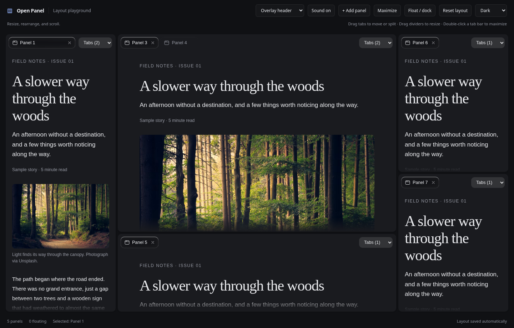
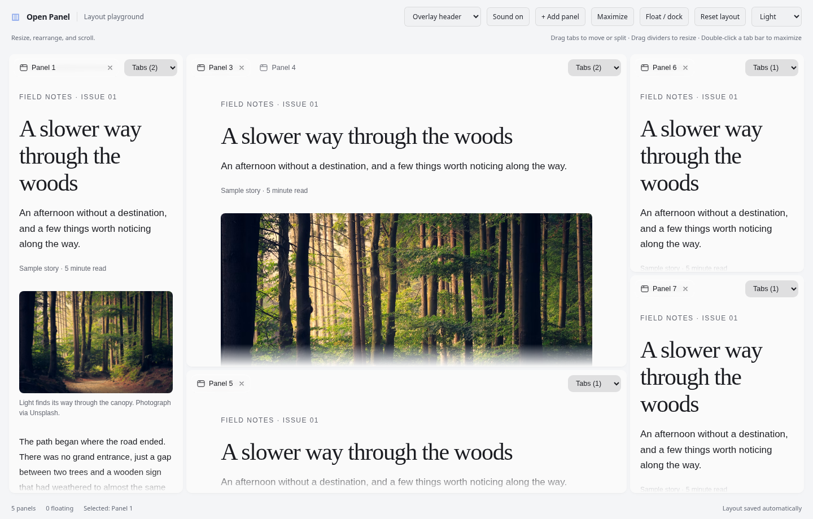

<div align="center">

# Open Panel

**A workspace that moves with your ideas.**

Dockable panels, adaptive tabs, floating windows, and independent scrolling — for React, web components, and plain TypeScript.

[Get started](#install) · [React](#react-quick-start) · [Customize](#headers-tabs-and-glass) · [Hooks](#control-the-workspace-from-anywhere) · [Run the playground](#local-development)

</div>



## What you get

- Drag tabs between groups, split panels, resize dividers, float/dock views, and maximize a panel.
- Compact headers show the selected tab at full width. A replaceable header slot can keep a tab picker within reach.
- Transparent workspace gutters, borderless panels, a fine top highlight, subtle resting shadows, and stronger shadows while dragging.
- Separate or overlay headers. Content can scroll behind the header without moving its drag targets.
- Automatic top/bottom scroll fades, including updates after images load or content changes.
- Serializable layouts, optional local persistence, controlled state, keyboard controls, and reduced-motion support.
- React hooks for workspace state, view state, commands, and events. Optional glass materials and quiet interaction sounds.

The screenshots come from the included playground. Its article text, photographs, toolbar, and page layout are example content; the panel behavior and styling are supplied by the packages.

## Install

Choose the adapter you need. A bundler supporting ES modules and CSS imports is recommended.

```sh
# React 18.3+ (in an existing React application)
pnpm add open-panel-core open-panel-react

# Plain TypeScript / JavaScript
pnpm add open-panel-core

# Custom elements, including non-React applications
pnpm add open-panel-core open-panel-element
```

Use `npm install` or `bun add` in place of `pnpm add` if preferred. Import the stylesheet once, and give the workspace a real height. In this checkout, `bun install` links the local workspace packages; the playground does not need a registry release.

| Package                                  | Responsibility                                                               |
| ---------------------------------------- | ---------------------------------------------------------------------------- |
| [`open-panel-core`](packages/core)       | Layout engine, DOM runtime, shared styling, persistence, scroll fades        |
| [`open-panel-react`](packages/react)     | Declarative layout, portals, replaceable slots, hooks, optional integrations |
| [`open-panel-element`](packages/element) | Light-DOM `<open-panel-workspace>` and template-based views                  |

## React quick start

```tsx
import { Workspace, ViewType, Split, Panel, View, PanelTabsMenu } from "open-panel-react";
import "open-panel-core/style.css";
import "./workspace.css";

export default function App() {
  return (
    <Workspace
      className="workspace"
      theme="dark"
      headerMode="overlay"
      storageKey="my-app:workspace"
      version={1}
    >
      <ViewType id="notes" title="Notes" headerAction={<PanelTabsMenu />}>
        <article className="article">
          <h1>A place for your ideas</h1>
          {Array.from({ length: 24 }, (_, index) => (
            <p key={index}>A paragraph of content to explore independent panel scrolling.</p>
          ))}
        </article>
      </ViewType>
      <Split weights={[2, 1]}>
        <Panel>
          <View id="first" type="notes" />
          <View id="second" type="notes" />
        </Panel>
        <View id="third" type="notes" />
      </Split>
    </Workspace>
  );
}
```

```css
.workspace {
  height: 80vh;
  min-height: 360px;
}
.article {
  padding: 24px;
  padding-top: calc(var(--open-panel-titlebar-height, 0px) + 24px);
  line-height: 1.7;
}
```

`ViewType` registers content; `View` creates an instance. `Panel` groups views as tabs. `Split` arranges children horizontally; `axis="y"` stacks them vertically. Use `Stage` for a central area that accepts dropped views.

**Preview:** the same panel chrome in light mode, with the playground's article content:



## Defaults and overrides

These defaults are shipped in the packages, with no dependency on `demo/src/styles.css`.

| Feature                      | Default                                                                        | Override                                                                |
| ---------------------------- | ------------------------------------------------------------------------------ | ----------------------------------------------------------------------- |
| Header                       | Separate from content                                                          | `headerMode="overlay"`                                                  |
| Scroll fade                  | Enabled, up to 40px per edge                                                   | `scrollFade={false}` or `scrollFade={{ size: 56 }}`                     |
| Tab layout                   | Natural widths; compact when tabs approach the available row width within 12px | `tabs={{ fill: false }}` or `{ fill: true }` for equal-width tabs       |
| Compact header               | Only active tab visible, filling available space                               | Use `useIsCompact()` for custom controls                                |
| Header control               | Built-in panel menu                                                            | `headerAction={<PanelTabsMenu />}`, any node/render function, or `null` |
| React prefix icon            | Single-tab icon                                                                | `icon={<YourIcon />}` or `icon={null}`                                  |
| Glass                        | Optional                                                                       | `GlassTabBackground` from the `/glass` entry                            |
| Sounds                       | Optional                                                                       | `useInteractionSounds` from the `/sounds` entry                         |
| Theme                        | System                                                                         | `light`, `medium`, `dark`, `darker`, `system`                           |
| Floating / navigation        | Overlay / focus                                                                | `floating={false}`, `navigation={false}`, or other supported modes      |
| Header height                | 48px                                                                           | `--open-panel-tabbar-height`                                            |
| Resize minimums              | 232px wide × 310px high                                                        | `--open-panel-resize-min-width`, `--open-panel-resize-min-height`       |
| Workspace / stage background | Transparent                                                                    | `--open-panel-bg`, `--open-panel-stage`                                 |

Resize minimums constrain interactive divider and floating-window resizing. When the available space cannot fit all minimums, compact limits allow resizing to continue. View `minSize` is a separate content-scaling setting.

## Headers, tabs, and glass

Header controls and backgrounds are separate from the core tab hit targets, so customization preserves drag and keyboard handling.

```sh
pnpm add @samasante/liquid-glass
```

```tsx
import { ViewType, PanelTabsMenu } from "open-panel-react";
import { GlassTabBackground } from "open-panel-react/glass";

<ViewType
  id="article"
  title="Field notes"
  tabBackground={<GlassTabBackground theme="dark" />}
  headerAction={<PanelTabsMenu />}
>
  <YourArticle />
</ViewType>;
```

Pass the same theme to `Workspace` and `GlassTabBackground`. The material starts with the playground's current optics; its `optics`, `radius`, and other Glass props can be overridden. Glass is hidden in the tiny panel/frame presentation. `PanelTabsMenu` remains available in compact mode and lists every tab in its panel.

`headerAction` also accepts `(view) => ReactNode`, for example:

```tsx
<ViewType
  id="notes"
  title="Notes"
  fullWidth
  headerAction={(view) => <button onClick={() => view.hide()}>Hide</button>}
/>
```

`fullWidth` lets an individual tab consume remaining row space. Omit `headerAction` for the built-in menu; use `null` for an empty replacement. Custom controls can call `useIsCompact()` to adapt their own rendering.

## Scrolling beneath the header

```tsx
<Workspace headerMode="overlay" scrollFade={{ size: 48 }}>
  {/* View types and initial layout */}
</Workspace>
```

The header stays fixed while the view content scrolls beneath it. Give the content initial padding using `--open-panel-titlebar-height`, as in the quick start. Switch to `headerMode="separate"` to reserve header space; the token becomes zero. Switching modes preserves mounted content.

Fades apply only to the content scroller, never to header controls. The top edge appears after scrolling down; the bottom edge disappears at the end. Short content has neither fade. Put overflowing content directly in the view instead of creating another scroll container if you want the automatic behavior. Cross-origin iframe contents manage their own scrolling.

For a custom scrolling element, core also exports a lifecycle helper:

```ts
import { attachScrollFade } from "open-panel-core";
const cleanup = attachScrollFade(myScrollElement, { size: 40 });
// Call when unmounting the custom scroller:
cleanup();
```

Add `data-open-panel-part="content"` within the workspace to reuse the shared fade stylesheet on that custom element. Disable the workspace's automatic fade if replacing its scroller.

## Control the workspace from anywhere

Wrap external toolbars and the workspace in the same `WorkspaceProvider`. Hooks resolve the nearest provider; separate providers isolate separate workspaces.

```tsx
import {
  WorkspaceProvider,
  Workspace,
  ViewType,
  View,
  useWorkspaceActions,
  useFocusedView,
} from "open-panel-react";

function Toolbar() {
  const actions = useWorkspaceActions();
  const focused = useFocusedView();
  return (
    <button disabled={!actions || !focused} onClick={() => focused && actions?.toggleDock(focused.id)}>
      Float / dock
    </button>
  );
}

function Editor() {
  return (
    <WorkspaceProvider>
      <Toolbar />
      <Workspace className="workspace">
        <ViewType id="notes" title="Notes">
          <textarea aria-label="Notes" />
        </ViewType>
        <View type="notes" />
      </Workspace>
    </WorkspaceProvider>
  );
}
```

| Hook                                                     | Use                                                            |
| -------------------------------------------------------- | -------------------------------------------------------------- |
| `useWorkspace()` / `useOptionalWorkspace()`              | Imperative handle; optional form returns `null` until ready    |
| `useWorkspaceState()` / `useWorkspaceSelector(selector)` | Live snapshot or selected derived state                        |
| `useWorkspaceActions()`                                  | Stable commands, `null` before mounting                        |
| `useWorkspaceEvent(event, handler)`                      | Event subscription with automatic cleanup and current callback |
| `useFocusedView()`                                       | Focused view or `null`                                         |
| `usePanelViews(panelId?)`                                | Ordered tabs for a panel; defaults to the enclosing panel      |
| `useView()` / `useOptionalView()`                        | Current view handle and presentation state                     |
| `useViewState(viewId?)`                                  | Subscribe to a specific or enclosing view                      |
| `useIsCompact()`                                         | Adapt content or header controls to the current compact state  |
| `useViewTitle`, `useViewBadge`, `useCloseGuard`          | Update view metadata and guard closure                         |

For fully controlled layouts, pass `document` and `onDocumentChange`. Otherwise use `storageKey`/`version` for local persistence, or call `getDocument()`/`setDocument()` on the handle. `reset()` restores the initial layout.

## Optional interaction sounds

```sh
pnpm add cuelume
```

```tsx
import { useOptionalWorkspace } from "open-panel-react";
import { useInteractionSounds } from "open-panel-react/sounds";

function SoundToggle() {
  const ws = useOptionalWorkspace();
  const { enabled, toggleSound } = useInteractionSounds(ws, {
    volume: 0.22,
    storageKey: "my-app:sounds",
    defaultEnabled: true,
  });
  return (
    <button aria-pressed={enabled} onClick={() => void toggleSound()}>
      Sound {enabled ? "on" : "off"}
    </button>
  );
}
```

Place this component inside your `WorkspaceProvider`. Cuelume unlocks audio through user interaction. Selection, opening, closing, and drag pickup/drop get quiet cues; hover and continuous movement stay silent. Persistence is opt-in through `storageKey`. Cuelume's volume and enabled state are shared globally: mount one sound controller per application. The core React entry does not import either optional integration.

## Plain TypeScript

```ts
import { createWorkspace, layout as L } from "open-panel-core";
import "open-panel-core/style.css";

const host = document.querySelector<HTMLElement>("#workspace")!;
host.style.height = "80vh";
const ws = createWorkspace(host, {
  theme: "dark",
  headerMode: "overlay",
  scrollFade: { size: 40 },
  persist: { key: "my-app:layout", version: 1 },
  types: {
    notes: {
      title: "Notes",
      mount(element) {
        const article = document.createElement("article");
        article.style.padding = "calc(var(--open-panel-titlebar-height, 0px) + 24px) 24px 24px";
        article.textContent = "Your content goes here.";
        element.append(article);
        return () => article.remove();
      },
    },
  },
  defaultLayout: L.row([L.view("notes"), L.stage()], [1, 2]),
});

ws.open("notes", { focus: true });
// When removing the application:
// ws.destroy();
```

## Custom elements

With a bundler, register the element and import its CSS in your entry module:

```ts
import "open-panel-element";
import "open-panel-core/style.css";
```

```html
<open-panel-workspace
  theme="light"
  header-mode="overlay"
  tab-fill="active"
  scroll-fade="true"
  style="display:block; height:80vh"
>
  <template data-view-type="notes" data-title="Notes" data-full-width="true">
    <article style="padding:calc(var(--open-panel-titlebar-height, 0px) + 24px) 24px 24px">
      <h1>Notes</h1>
      <p>Your content goes here.</p>
    </article>
  </template>
  <open-panel-split weights="1 2">
    <open-panel-view type="notes"></open-panel-view>
    <open-panel-stage></open-panel-stage>
  </open-panel-split>
</open-panel-workspace>
```

Set `.options = { scrollFade: { size: 56 } }` for richer options. The `.workspace` property exposes the core handle after `open-panel-ready`. For use without a bundler, serve `dist/open-panel-element.standalone.js` and `dist/style.css` from the element package and reference their actual URLs; bare package names require a bundler or import map.

## Theme and CSS customization

```tsx
<Workspace
  theme="light"
  tokens={{
    "--open-panel-accent": "#6586e8",
    "--open-panel-resize-min-width": "180px",
    "--open-panel-resize-min-height": "160px",
    "--open-panel-tabbar-height": "52px",
  }}
>
  {/* Your views */}
</Workspace>
```

The shared stylesheet uses low-specificity selectors. Target stable parts such as `[data-open-panel-part="panel"]`, `tab`, `tabbar`, `content`, and `divider` in your stylesheet. CSS decoration does not replace the engine's hit areas. Keep focus indicators visible when overriding them.

## Local development

```sh
bun install
bun run dev                    # playground; default host is configured in demo/package.json
# Override the host for another machine:
bun run --cwd demo dev --host 127.0.0.1 --port 5312

bun run typecheck              # core, adapters, and demo
bun run test                   # model, DOM, lifecycle, and SSR tests
bun run build                  # packages, declarations, and CSS
bun run --cwd demo build       # production playground
```

The demo resolves local package source for live development. Package builds produce `dist` exports for consumers. See [React reference](packages/react/README.md), [core reference](packages/core/README.md), and [element reference](packages/element/README.md) for adapter details.

## Tab context menus and scrollbars

`onTabContextMenu={({ event, view, panelId, tab }) => ...}` exposes tab gestures.
Return `false` to hand the bubbling event to a consumer's context-menu trigger;
call `event.preventDefault()` when opening your own menu directly. Keyboard menu
gestures follow the same path. See the [React + COSS integration example](docs/context-menu.md).

Content scrollbars use transparent tracks and subtle theme-aware thumbs. Override
`--open-panel-scrollbar-thumb` and `--open-panel-scrollbar-thumb-hover` through CSS
or `Workspace.tokens`. The native scrollbar keeps platform scrolling behavior and
uses system colors in forced-color mode.
